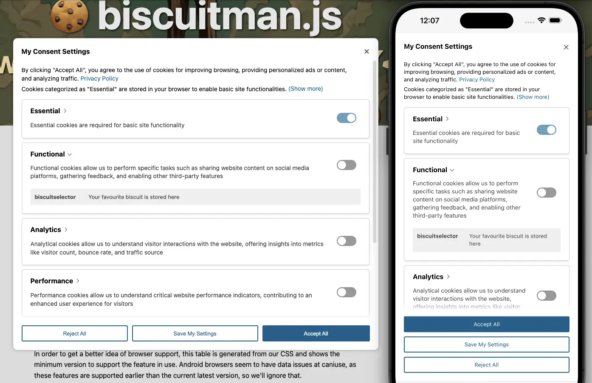

# biscuitman.js 🍪 Lightweight Consent Manager

[](https://github.com/replete/biscuitman/actions/workflows/node.js.yml) [](https://automate.browserstack.com/public-build/QmsxRjJMaGZ2dk9zNS9Mcm40dzBlaHU3TG9Xa0thS0ZYKzhiM2t6YXBJVT0tLWgvSWZyRFNMbDVVYzFnZjdSUEhubWc9PQ==--aa5279df24a33d520da213e3b13e3d256d90478f) (Legacy [](https://automate.browserstack.com/public-build/NXh6bEVSMFo0WEdKNytRbjM3UU1ISHFrZGVTNDJyZmpTVW1adkwzeVc1az0tLVBYaGdYa2JDblMzVW5EZGZqZC9zOEE9PQ==--a10fddff63f0f52e50c6c8cc92dbf40e467dcac7))

Biscuitman is a super lightweight, customizable consent manager for your website. Weighing in around 3-4kB compressed, it's designed to be fast-loading and easy to implement with a flat configuration object.



#### [View demo](https://replete.github.io/biscuitman)

## Features overview

- Stores consent in `localStorage`, exposes in `window.Consent` and through custom events fired on `document`
- Handles consent granulated by custom sections (e.g. essential, performance, analytics...)
- Optionally shows user specific cookie (or localStorage item) details
    - Cookies/localstorage items removed on rejection/invalidation, if cookie details added
- Fully customizable strings so you can serve localized strings if you want
- Overridable localStorage key, consent global
- Basic color theming via CSS variables
- Simple flat configuration object
- Injects scripts when granular consent is granted (`<script data-consent="analytics" type="text/plain" src="..."></script>`)
- Injects embedded 'after' `<script>` from script tags with `src` properties on onload (= less markup)
- Mobile-first responsive design
- 'Show more' functionality for long disclaimer text
- include optional link in any text
- CSS classes on `<html>` element for consents
- Progressively enhanced CSS
- Accessible: labelled landmarks and controls, keyboard operable, checked with [axe](https://github.com/dequelabs/axe-core)
- Also packaged as an ES module, `biscuitman.mjs` (see [ESM demo](https://replete.github.io/biscuitman/index-esm.html))
- Legacy version included for supporting 2013+ era browsers (see [legacy demo](https://replete.github.io/biscuitman/index-legacy.html))

## Install

```sh
npm install biscuitman
```

Or load it from a CDN (pin a version in production):

```html
<script src="https://cdn.jsdelivr.net/npm/biscuitman/dist/biscuitman.withcss.min.js"></script>
```

Or download the files in `dist/` from a [release](https://github.com/replete/biscuitman/releases). The `withcss` files include the styles; the others need `biscuitman.css` as well.

## How to use

The [demo](https://replete.github.io/biscuitman) runs this setup with real analytics scripts (using dummy IDs). View its source for a complete configuration.

```html
<!--
	1. Prepare script tags
	   - set 'type' property to "text/plain" to prevent execution
	   - add 'data-consent' property with consent section name (e.g. analytics, functional, performance)
-->
<script
	data-consent="analytics"
	async
	src="https://www.googletagmanager.com/gtag/js?id=G-TEST"
	type="text/plain"
	id="js-analytics-gtm"
>
	// The contents of this script are injected after load, adjacent to the parent script (convenience)
	console.log('GTM loaded:', !!google_tag_manager)
</script>
<script data-consent="analytics" type="text/plain" id="js-analytics-misc">
	console.log('This script runs as soon as analytics section consent is granted')
</script>

<!--
	2. Configure biscuitman settings
	   - window.biscuitman must be defined before biscuitman is loaded
	   - section titles and messages must be defined here, the library has no defaults for them
-->
<script>
	biscuitman = {
		/* Default properties */

		// key: 'myconsent',  // the key to store consent choices in localStorage
		// global: 'Consent',  // global window object to access consents at runtime
		// force: false,  // this forces the modal open at start and prevents website access without choosing consent
		// enableMore: true,   // Hide multiple lines of info text behind a 'show more' link to keep UI short
		// sections: ['essential'],   // a section is a group of consent choices, you must define your section names in configuration
		// title: 'Your privacy matters',   // Banner title
		// message: 'We use cookies',   // Banner message
		// settings: 'Settings',   // Settings button text
		// reject: 'Reject All',   // Reject button text
		// accept: 'Accept All',   // Accept button text
		// save: 'Save My Settings',   // Modal settings button text
		// close: 'Close',   // Modal close button accessible name (aria-label)
		// settingsTitle: 'My Consent Settings',   // Modal title
		// info: ``,   // Multi-line information at top of modal
		// more: 'Show more', // Show more button text
		// noCookies: 'No cookies to display', // Displayed in expanded sections within modal
		// acceptNonEU: false, // When enabled biscuitman checks browser locale timezone to see if it matches EU, if not it will auto consent (unless the visitor already made a choice, or the browser cannot report a timezone)
		dialogPolyfill: '/dist/dialog-polyfill.withcss.min.js', // set to false to disable dialog polyfill loading

		message:
			'By clicking "Accept All", you agree to the use of cookies for improving browsing, providing personalized ads or content, and analyzing traffic. {link}',
		// {link} inside any configuration string will be replaced with an <a> link

		linkText: 'Privacy Policy',
		linkURL: 'https://domain.com/privacy-policy',

		// info uses a template literal so it can span multiple lines
		info: `Cookies categorized as "Essential" are stored in your browser to enable basic site functionalities.
Additionally, third-party cookies are utilized to analyze website usage, store preferences, and deliver relevant content and advertisements with your consent.
While you have the option to enable or disable some or all of these cookies, note that disabling certain ones may impact your browsing experience.`,

		// Define as many sections as desired, each section represents a granular consent and is fundamental to the software
		// You can name sections anything you want, but they must not use spaces or special characters
		// e.g. data-consent="advertisement" on a script tag matches the 'advertisement' section
		sections: ['essential', 'functional', 'analytics', 'advertisement', 'uncategorized'],

		// 'essential' is special because it doesn't need consent and its toggle is disabled in the UI
		essentialTitle: 'Essential',
		essentialMessage: 'Essential cookies are required to enable the basic features of this site',

		// The naming convention is {sectionName}Title, {sectionName}Message, and {sectionName}Cookies
		functionalTitle: 'Functional',
		functionalMessage:
			'Functional cookies help perform functions like sharing the content of the website on social media platforms, collecting feedback, and other third-party features',
		advertisementTitle: 'Advertisement',
		advertisementMessage:
			'Advertisement cookies serve to deliver tailored advertisements to visitors based on their previous page visits and to evaluate the efficacy of advertising campaigns',
		uncategorizedTitle: 'Uncategorized',
		uncategorizedMessage:
			'Uncategorized cookies are those currently under analysis and have not yet been assigned to a specific category',
		analyticsTitle: 'Analytics',
		analyticsMessage:
			'Analytical cookies are used to understand how visitors interact with the website. These cookies help provide information on metrics such as the number of visitors, bounce rate, traffic source, etc.',

		// (Optional) Include details of the cookies in use for a section, add them like a name/value dictionary
		// NOTE: By default, if these exist, then when consent is rejected/invalidated, these cookies/localStorage entries will be immediately removed. Wildcards only work at the end of a string.
		analyticsCookies: {
			_ga: 'This cookie, set by Google Analytics, computes visitor, session, and campaign data, tracking site usage for analytical reports. It stores information anonymously, assigning a randomly generated number to identify unique visitors',
			'_ga_*': 'Google Analytics uses this cookie for storing page view count'
		}
	}
</script>

<!--
	3. Include Biscuitman files:
-->
<script src="biscuitman.withcss.min.js"></script>

<!-- or, if you want to load CSS separately: -->
<head>
	<link rel="stylesheet" href="biscuitman.min.css" />
	<script src="biscuitman.min.js"></script>
</head>
```

## ESM version

The same code packaged as an ES module, for bundlers and `<script type="module">`. ([ESM demo](https://replete.github.io/biscuitman/index-esm.html))

With a bundler, the package exposes:

- `biscuitman` – the ESM version, without styles
- `biscuitman/withcss` – the ESM version, which injects its own styles
- `biscuitman/css` – the stylesheet

```html
<script type="module" id="biscuitman-init">
	import biscuitman from './dist/esm/biscuitman.withcss.mjs'
	let bm = biscuitman
		.create({
			// ...options
		})
		.on('save', (data) => {
			// optional event callback
			console.log('ESM version: consents were saved', data.data)
		})
		.on('revoke', (data) => {
			// optional event callback
			if (data.section === 'analytics') {
				console.log('ESM version: analytics was revoked')
			}
		})
</script>
```

`biscuitman.create(options)` returns a single instance (calling it again returns the same one) with:

- `on(event, callback)` / `off(event, callback)` – listen for the [events](#events) below, without the `bm:` prefix
- `consent(sectionName)` – `true` if that section is consented
- `update()` – open the settings modal
- `invalidate()` – delete stored consent and show the banner again

## Theme CSS

It's easy enough to theme the included styles by overriding CSS variables. They are shortened but straightforward:

```css
/* hacker mode */
.biscuitman {
	--bm-c: limegreen;
	--bm-bg: #000;
	--bm-tx: #fff;
	--bm-ui: 255, 255, 255;
	font-family: monospace;
}
/* Dark mode */
@media (prefers-color-scheme: dark) {
	.biscuitman {
		--bm-c: #1586c6;
		--bm-bg: #000;
		--bm-tx: #fff;
		--bm-ui: 255, 255, 255;
	}
}
```

The banner height is applied as a px value to the `var(--bm-height)` css variable on html so that you can add an offset style when it is visible to make sure no content is obscured by the banner. This is an offset fix that uses generated content, but you might implement something else based on margin/padding depending on your site layout design.

```css
html.bm-show::after {
	content: '';
	min-height: var(--bm-height);
	/* min-height: calc(var(--bm-height) + 20px) */
	display: block;
}
```

The value is kept current as the banner changes height (for example when its text re-wraps), and is `0px` while the banner is hidden.

If you offset a fixed element by the banner height, prefer a transform over `bottom`, because moving an element with a transform does not count as a layout shift:

```css
.my-fixed-bar {
	transform: translateY(calc(-1 * var(--bm-height)));
}
```

## Browser Support

Biscuitman is written in modern Javascript and built with `swc`. The included distributables are tested to support the following browsers:

- Chrome/Edge/Opera: 85+ (released June 2020)
- Firefox: 98+ (released March 2022)
- Safari (inc iOS): 15.4+ (released March 2022)
- Samsung Internet: 14+ (released April 2021)

### \<Dialog\> polyfill

To support older than the browsers above, a polyfill for `<dialog>` is required. Biscuitman checks for this automatically and loads a [polyfill for dialog](https://github.com/GoogleChrome/dialog-polyfill) on-demand (if it is not already loaded), and then correctly binds the UI.

For this to work, you must host `dist/dialog-polyfill.withcss.js` and set the config property `dialogPolyfill` to the correct URL.

This will extend the browser support to:

- Safari (inc iOS) 13.1+ (released March 2020)
- Firefox 77+ (released June 2020)
- Firefox Android 79+ (released August 2020)

If the dialog polyfill is already loaded (`window.dialogPolyfill` exists), the polyfill will not be loaded again. To disable this on-demand functionality altogether, set `dialogPolyfill` property to `false`.

### Legacy Browser Support

If you need to support really old browsers, use `biscuitman-legacy.js`, `biscuitman-legacy.min.js` or `biscuitman-legacy.withcss.js` ([legacy demo](https://replete.github.io/biscuitman/index-legacy.html)) to extend the browser support to:

- Safari 7+ / 6.2+ (released Oct 2013)
- Chrome 24+ (released Jan 2013)
- Firefox 24+ (released Sep 2013)
- IE 11+ (released Oct 2013)

This legacy version is transpiled to ES5 and includes required polyfills to make itself functional on these ancient browsers. This makes the distributables roughly double the filesize of the modern versions.

In these extremely old browsers, the functionality is intact and the UI is usable but it may look slightly janky as the browser is missing CSS features like `gap` resulting in missing gaps between buttons.

## Globals

- `biscuitman` – configuration object, must be `window.biscuitman`
    - `biscuitman.create(options)` for the ESM version
- `Consent` – object for accessing consents (override: `global` in config)

    ```
    {
    	"consentTime": 1717846660979,
    	"functional": false,
    	"analytics": false,
    	"performance": false,
    	"advertisement": false,
    	"uncategorized": false
    }
    ```

    - example usage: `if (Consent.analytics) { doAnalyticsThing() }`

- `bmInvalidate()` – Delete stored consent data and reinstate UI (you might use this in your app code)
- `bmUpdate()` – Opens My Consent Settings modal (you might want to link this on your Privacy policy or footer nav)
    - example usage: `<a href="javascript:bmUpdate();"> Update my consent settings</a>`

## CSS Classes

- `biscuitman` on UI container
- `bm-{sectionName}`, `bm-no-{sectionName}`, `bm-show` and sometimes `bm-dialog-polyfill` on `<html>`
- `--bm-height` CSS variable written to `<html style="--bm-height:0px;">`

## Events

Custom events prefixed with `bm:` are fired on `document`. The easiest way to see how events work is to view the `console.debug()` calls in the [demo](https://replete.github.io/biscuitman).

- `bm:open` => `{time: 1718915128298}` modal opened
- `bm:close` => `{time: 1718915128298}` modal closed
- `bm:button` => `{id: "settings", time: 1718915128298}` button clicked
- `bm:save` => `{data: {consentTime: 1718914784624, analytics: true, advertisement: fal..}, time: 1718914784624}` consent choice saved
- `bm:inject` => `{el: $Element, parent?: $Element, id?: 'script-id', time: 1718914784624}` script injected to DOM. if parent exists, it's a new tag inserted after a `src` script loaded which also had text content (a 'dependent' script = tidier convenient markup)
- `bm:invalidate` => `{data: {...consentObjectJustDeleted}, time: 1718915128298}` consent invalidated
- `bm:revoke` => `{section: 'analytics', time: 1718914784624}` returns section that was revoked if updated consent changed from true to false
- `bm:update` => `{data: {...currentConsentObject}, time: 1718914784624}` returns current consent object and time
- `bm:delete` => `{localStorage|cookie: 'cookieName', time: 1718914784624}` fires when consent is rejected or invalidated and cookies/localStorage entries are deleted

You can watch for these events like this:

```js
document.addEventListener('bm:save', ({ detail }) => {
	let { data, time } = detail
	console.log(data)
})
```

## Development

`npm run dev` builds the project and starts a [Vite](https://vite.dev) development server on `https://localhost:3000`, rebuilding and reloading when anything in `src/` changes.

We need `https://` to be able to delete Secure cookies.

### Fix NET::ERR_CERT_AUTHORITY_INVALID error

To prevent invalid certificate warnings, you can generate a local SSL key with `mkcert`:

- Install `mkcert` ([Installation instructions](https://github.com/FiloSottile/mkcert#installation)) and then run:
- run `npm run makecerts`, to generate `server.crt` and `server.key` for the dev server (without them it falls back to `http://`)
- if you're using another solution for local SSL certs, generate `server.crt` and `server.key` manually and place them in the root

Visiting `https://localhost:3000` should now work without warnings.

### Building

`npm run build` - creates project distributes via `run.js`, a custom build script requiring Node 22.18+ or 24.11+

The build also writes the three demo pages (`index.html`, `index-esm.html`, `index-legacy.html`) from one template, `src/demo.html`. Edit the template, not the pages.

### Tests

[Playwright](https://playwright.dev) runs the end-to-end tests against every bundle in `dist/`, in a real Chromium. Each test gets its own isolated browser context, so they all run in parallel. The test page and the `dist/` assets are served from memory and disk by Playwright's request interception, so no dev server or port is needed.

Install the browser once after cloning:

`npx playwright install chromium`

Then:

`npm run test` - runs the full suite against all 12 bundle variants (CI runs `biscuitman.js` only)

`npm run test:ui` - opens Playwright's interactive UI mode for debugging

`npm run test:report` - opens the HTML report from the last run

#### Real browsers

A smaller smoke test runs on [BrowserStack](https://www.browserstack.com) in the oldest browsers listed under [Browser Support](#browser-support), and saves screenshots to `__tests__/reports/browserstack/`. It needs a BrowserStack account, with `BROWSERSTACK_USERNAME` and `BROWSERSTACK_ACCESS_KEY` set in the environment or a `.env` file.

`npm run test:browserstack` - modern bundle

`npm run test:browserstack:legacy` - legacy bundle

`npm run test:browserstack -- --local` - same checks in local Chrome, no account needed

## Support development

<a href="https://www.buymeacoffee.com/replete"></a>
